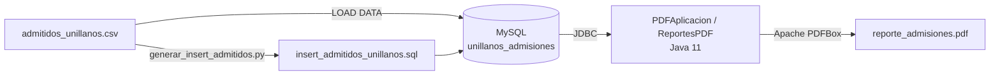

<div align="center">
  <h1>Taller PDF: Reportes de Admisiones Unillanos</h1>
  <p><b>Generador de reportes PDF a partir de datos de admisiones en MySQL</b><br/>Taller académico con datos de admitidos de la Universidad de los Llanos</p>

  
  
  
  
  
  
  <a href="LICENSE"></a>
</div>

<details>
<summary><b>English summary</b></summary>

Taller PDF is an academic exercise that generates a PDF report of university admissions. A Java 11 application built with Maven connects to MySQL through JDBC, runs aggregate queries over an anonymized dataset of 11,927 admitted students from Universidad de los Llanos (Colombia) and renders the results with Apache PDFBox as paginated tables with repeated headers: admitted students per academic program and men/women per faculty.

The repository also includes the SQL schema, a `LOAD DATA` script to import the CSV, a Python script that converts the CSV into batched `INSERT` statements, and a set of SQL views for quick analysis.

</details>

## Qué es

El taller consiste en producir un documento PDF con estadísticas de admisión directamente desde una base de datos, sin pasar por hojas de cálculo. Los datos son un CSV anonimizado con 11.927 registros de admitidos de la Universidad de los Llanos (año, periodo, género, colegio de origen, programa, facultad, sede, entre otros campos). El repositorio cubre todo el recorrido: crear la base de datos, cargar el CSV, consultar con SQL y dibujar las tablas en el PDF con Apache PDFBox.

## Funcionalidades

- Generación de un PDF tamaño carta con portada (título y fecha de generación) y dos reportes:
  - **Reporte 1:** cantidad de admitidos por programa académico, ordenada de mayor a menor.
  - **Reporte 2:** hombres, mujeres y total por facultad.
- Tablas paginadas: cuando una tabla no cabe en la página se crea una nueva y se repite el encabezado. Los textos que exceden el ancho de la columna se recortan con puntos suspensivos.
- Carga de datos de dos maneras: `LOAD DATA LOCAL INFILE` desde el CSV o un script SQL con `INSERT` por lotes de 500 filas generado en Python.
- Limpieza de datos durante la carga: números con separador de miles (`2,021`), fechas en formato `MM/DD/YYYY hh:mm:ss AM/PM` y encabezados del CSV con errores de digitación mapeados por posición.
- Vistas SQL de apoyo para análisis por año y periodo, facultad y programa, sede, género por programa y los 20 colegios con más admitidos.

Un ejemplo del documento generado está en [`reporte_admisiones.pdf`](reporte_admisiones.pdf).

## Arquitectura



- **`ReportesPDF`** abre una conexión JDBC, ejecuta las consultas de agregación con `PreparedStatement` y dibuja cada reporte con un método genérico `drawTable` que recibe encabezados, filas y anchos de columna.
- **`PDFAplicacion`** es el punto de entrada: recibe la ruta de salida como argumento (por defecto `reporte_admisiones.pdf`) y define los datos de conexión.
- **Esquema con índices** sobre `anio`, `programa` y `facultad`, que son las columnas por las que se agrupa en los reportes y en las vistas.
- **Codificación `utf8mb4`** en la base de datos y en la conexión JDBC para conservar tildes y eñes de los nombres de programas, municipios y colegios.

## Stack tecnológico

| Capa | Tecnología |
| --- | --- |
| Lenguaje | Java 11 |
| Construcción | Apache Maven |
| Generación de PDF | Apache PDFBox 2.0.30 |
| Acceso a datos | MySQL Connector/J 8.4.0 (JDBC) |
| Base de datos | MySQL 8 |
| Preparación de datos | Python 3 (biblioteca estándar: `csv`, `datetime`) |

## Puesta en marcha

### Requisitos

- Java JDK 11 o superior
- Apache Maven 3.6 o superior
- MySQL Server 8.0 o superior
- Python 3.7 o superior (solo para regenerar el script de `INSERT`)

### 1. Clonar el repositorio

```bash
git clone https://github.com/Joan-Mora/Taller-PDF.git
cd Taller-PDF
```

### 2. Crear la base de datos y cargar los datos

**Opción A: carga desde el CSV (recomendada).** Antes de ejecutarlo, ajusta en `scripts/create_and_load_unillanos.sql` la variable `@csv_path` con la ruta absoluta de `admitidos_unillanos.csv` en tu equipo.

```sql
-- En MySQL Workbench o en el cliente mysql (iniciado con --local-infile=1)
SET GLOBAL local_infile = 1;
SOURCE scripts/create_and_load_unillanos.sql;
SOURCE scripts/views_unillanos.sql;
```

**Opción B: carga con `INSERT`.** El archivo `scripts/insert_admitidos_unillanos.sql` ya viene generado, pero no crea la tabla: primero ejecuta la parte de creación (`CREATE DATABASE` y `CREATE TABLE`) de `create_and_load_unillanos.sql`. Si necesitas regenerarlo, pasa las rutas como argumentos, porque las rutas por defecto del script apuntan a otra carpeta:

```bash
python scripts/generar_insert_admitidos.py admitidos_unillanos.csv scripts/insert_admitidos_unillanos.sql

mysql -u root -p < scripts/insert_admitidos_unillanos.sql
mysql -u root -p < scripts/views_unillanos.sql
```

### 3. Configurar la conexión

Los datos de conexión están en `src/main/java/com/taller/PDFAplicacion.java`. Cámbialos por los de tu servidor MySQL:

```java
ReportesPDF gen = new ReportesPDF("localhost", 3306, "unillanos_admisiones", "root", "<tu_contraseña>");
```

### 4. Compilar y ejecutar

```bash
mvn clean package
```

Desde Maven:

```bash
mvn compile org.codehaus.mojo:exec-maven-plugin:3.5.0:java \
  -Dexec.mainClass=com.taller.PDFAplicacion \
  -Dexec.args="reporte_admisiones.pdf"
```

Con el JAR: el `pom.xml` no empaqueta las dependencias dentro del JAR, así que hay que copiarlas y agregarlas al classpath.

```bash
mvn dependency:copy-dependencies
# Linux/macOS (en Windows usa ; en lugar de :)
java -cp "target/taller-pdf-1.0-SNAPSHOT.jar:target/dependency/*" com.taller.PDFAplicacion reporte_admisiones.pdf
```

También se puede ejecutar `PDFAplicacion.main()` desde el IDE. El PDF se genera en el directorio de trabajo.

## Reportes generados

### Reporte 1: admitidos por programa

```sql
SELECT programa, COUNT(*) AS total
FROM admitidos
GROUP BY programa
ORDER BY total DESC, programa;
```

### Reporte 2: hombres y mujeres por facultad

```sql
SELECT facultad,
  SUM(CASE WHEN genero='MASCULINO' THEN 1 ELSE 0 END) AS hombres,
  SUM(CASE WHEN genero='FEMENINO'  THEN 1 ELSE 0 END) AS mujeres
FROM admitidos
GROUP BY facultad
ORDER BY facultad;
```

La columna "Total" del PDF se calcula en Java como la suma de ambas.

## Esquema de base de datos

### Tabla `admitidos`

| Campo | Tipo | Descripción |
|-------|------|-------------|
| `id` | INT | Identificador (autoincremental) |
| `anio` | SMALLINT | Año de admisión |
| `periodo` | TINYINT | Periodo académico |
| `tipo_hecho` | VARCHAR(20) | Tipo de registro |
| `genero` | VARCHAR(12) | Género |
| `estado_civil` | VARCHAR(20) | Estado civil |
| `fecha_nacimiento` | DATE | Fecha de nacimiento |
| `pais` | VARCHAR(80) | País de origen |
| `ciudad_nacimiento` | VARCHAR(120) | Ciudad de nacimiento |
| `ciudad_residencia` | VARCHAR(120) | Ciudad de residencia |
| `departamento_colegio` | VARCHAR(120) | Departamento del colegio |
| `municipio_colegio` | VARCHAR(120) | Municipio del colegio |
| `colegio` | VARCHAR(200) | Nombre del colegio |
| `naturaleza_colegio` | VARCHAR(20) | Oficial o no oficial |
| `snies` | INT | Código SNIES del programa |
| `programa` | VARCHAR(200) | Programa académico |
| `facultad` | VARCHAR(200) | Facultad |
| `modalidad` | VARCHAR(80) | Modalidad |
| `metodologia` | VARCHAR(80) | Metodología |
| `sede` | VARCHAR(200) | Sede |

Índices: clave primaria en `id` e índices `idx_anio`, `idx_programa` e `idx_facultad`.

### Vistas de análisis

`scripts/views_unillanos.sql` crea estas vistas:

| Vista | Contenido |
| --- | --- |
| `v_admitidos_por_anio_periodo` | Admitidos por año y periodo |
| `v_admitidos_por_facultad_programa` | Admitidos por facultad y programa |
| `v_admitidos_por_sede` | Admitidos por sede |
| `v_genero_por_programa` | Distribución por género en cada programa |
| `v_top_colegios` | Los 20 colegios de origen con más admitidos |

## Solución de problemas

| Error | Causa y solución |
| --- | --- |
| `Access denied for user` | Las credenciales de `PDFAplicacion.java` no coinciden con las de tu servidor MySQL. |
| `Table doesn't exist` | Falta crear la base de datos y la tabla con `create_and_load_unillanos.sql`. |
| `The used command is not allowed with this MySQL version` | `local_infile` está deshabilitado: ejecuta `SET GLOBAL local_infile = 1;` y conecta el cliente con `--local-infile=1`. |
| `NoClassDefFoundError` al ejecutar el JAR | Faltan PDFBox o el driver de MySQL en el classpath; ver el paso 4. |

## Estructura del repositorio

```
Taller-PDF/
├── src/main/java/com/taller/
│   ├── PDFAplicacion.java              # Punto de entrada y datos de conexión
│   ├── ReportesPDF.java                # Consultas y dibujo de los reportes
│   └── PDF.java                        # Clase auxiliar mínima para crear PDFs
├── scripts/
│   ├── create_and_load_unillanos.sql   # Base de datos, tabla y carga del CSV
│   ├── generar_insert_admitidos.py     # CSV a INSERT por lotes
│   ├── insert_admitidos_unillanos.sql  # INSERT ya generados
│   └── views_unillanos.sql             # Vistas de análisis
├── admitidos_unillanos.csv             # Dataset anonimizado (11.927 registros)
├── reporte_admisiones.pdf              # Ejemplo de salida
└── pom.xml
```

## Autoría

<table>
  <tr>
    <td align="center"><a href="https://github.com/Joan-Mora"><br/><b>Darwin Joan Aveiga Mora</b></a><br/><sub>Desarrollo completo: modelo de datos, carga, consultas y generación del PDF</sub></td>
  </tr>
</table>

Taller académico desarrollado como estudiante de UNIMINUTO (Corporación Universitaria Minuto de Dios). Los datos de admisiones corresponden a la Universidad de los Llanos.

## Licencia

Copyright © 2025-2026 Darwin Joan Aveiga Mora. **Todos los derechos reservados.**

Este repositorio es público para que el código pueda consultarse como parte de mi portafolio. Eso no concede permiso para copiarlo, reutilizarlo, modificarlo, distribuirlo ni presentarlo como trabajo propio. Los términos completos están en [`LICENSE`](LICENSE). Para cualquier uso, escribe a [darwin@abacore.co](mailto:darwin@abacore.co).

<div align="center">
<sub>Hecho por <a href="https://github.com/Joan-Mora">Darwin Aveiga</a> · <a href="https://abacore.co">Abacore S.A.S.</a></sub>
</div>
